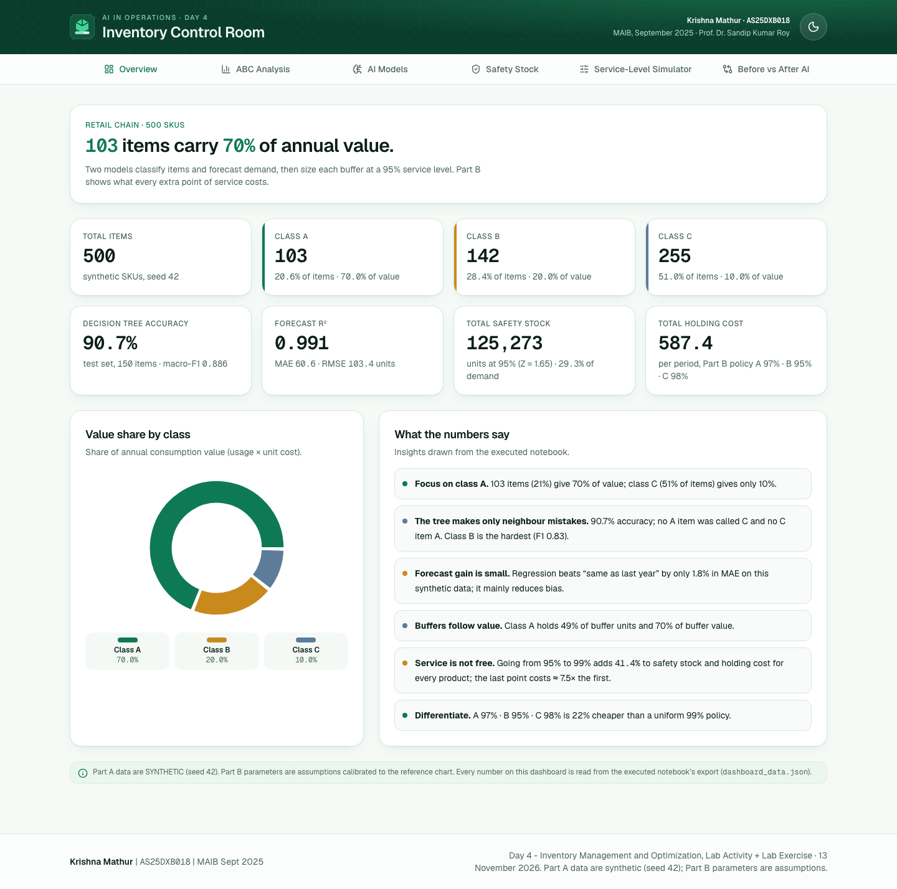
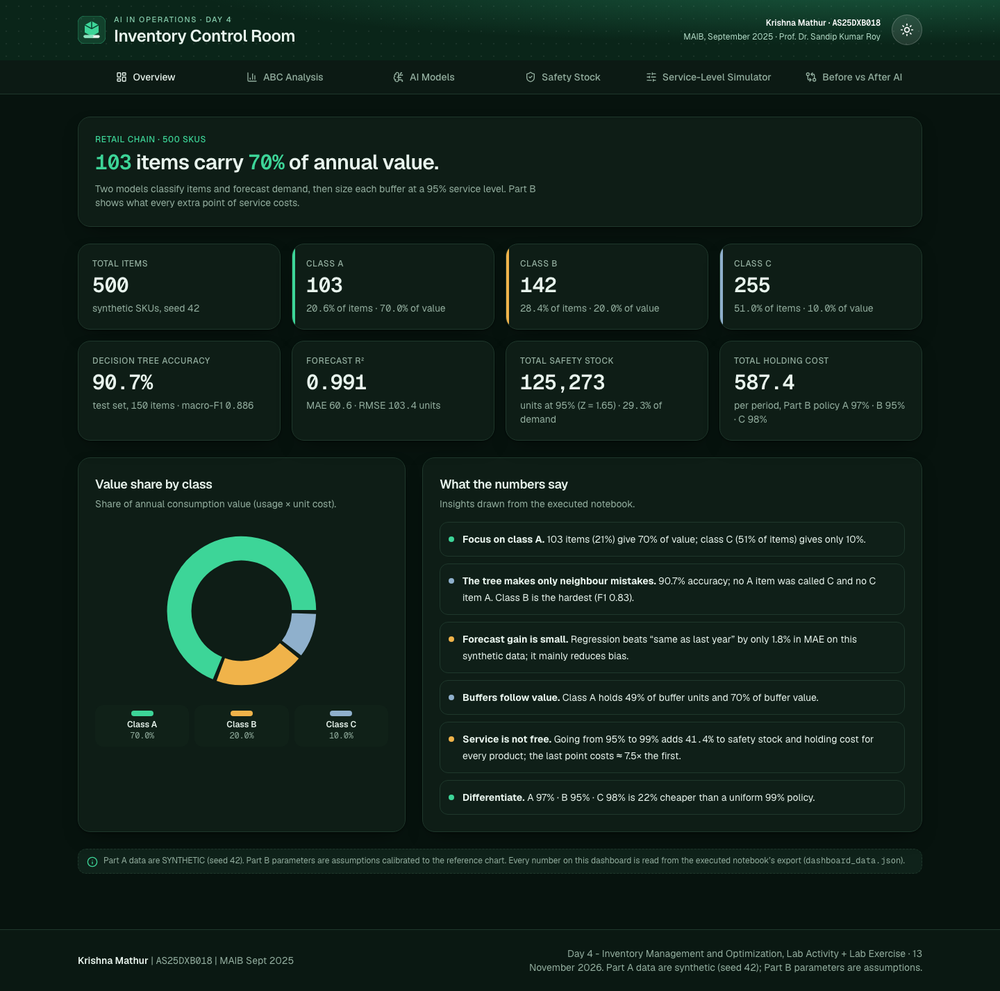
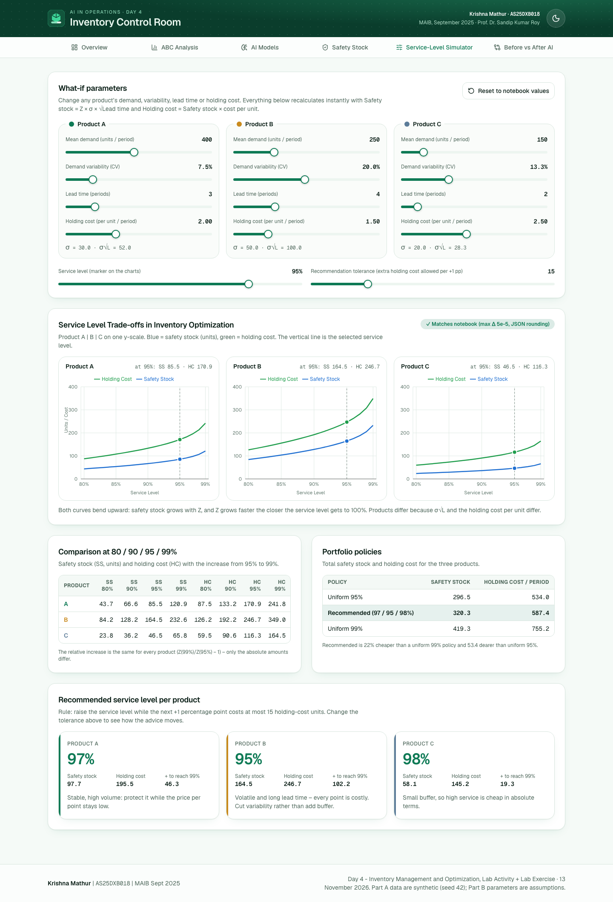
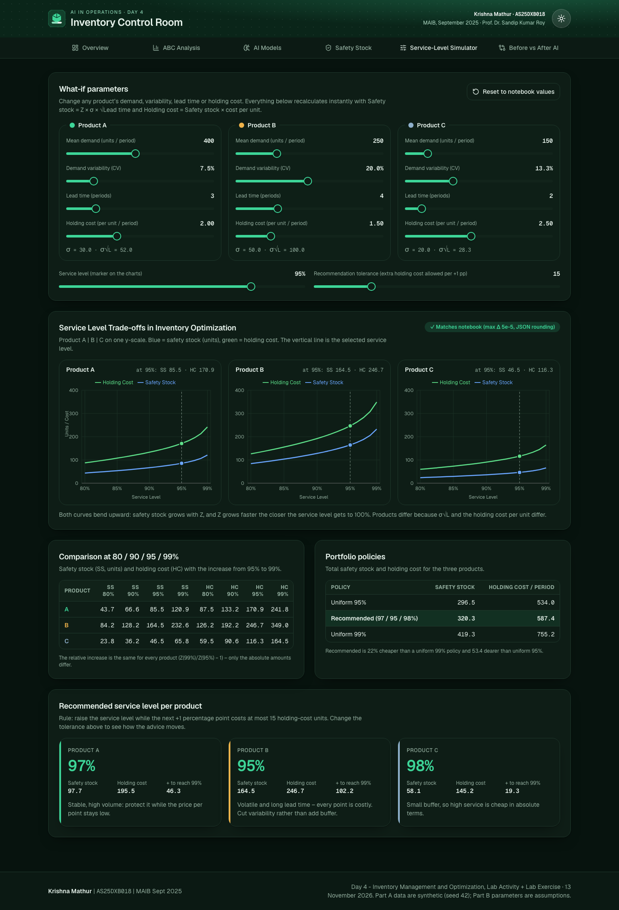
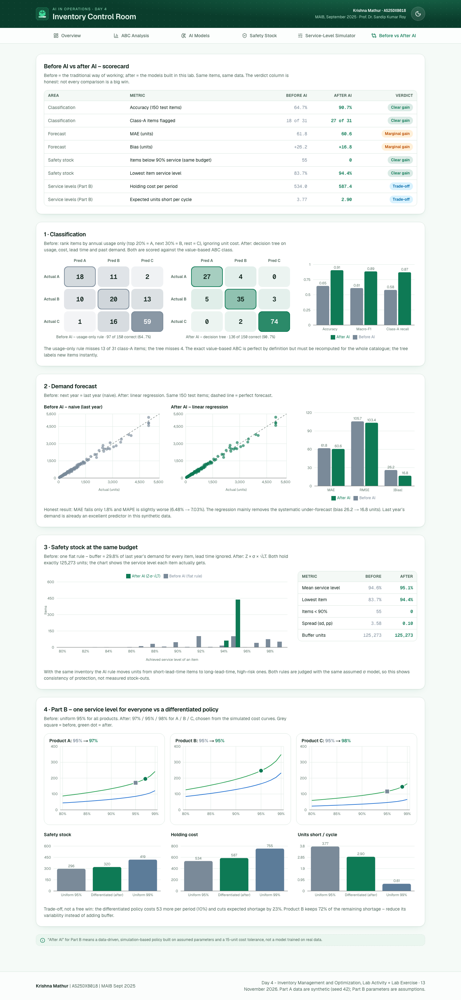
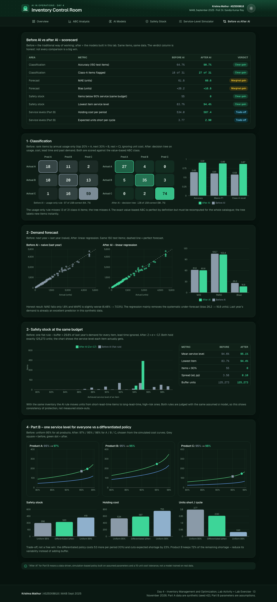
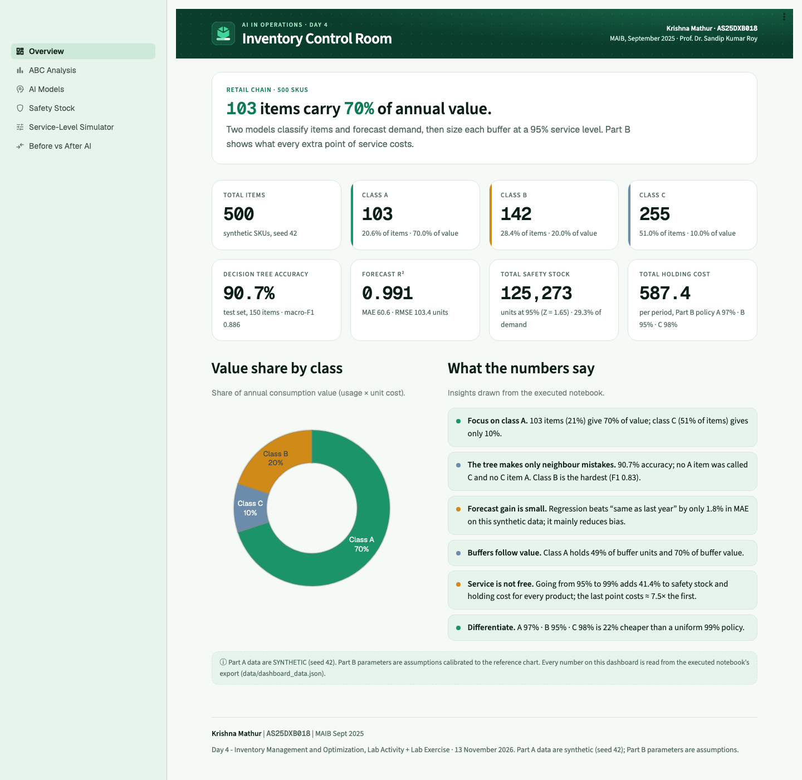
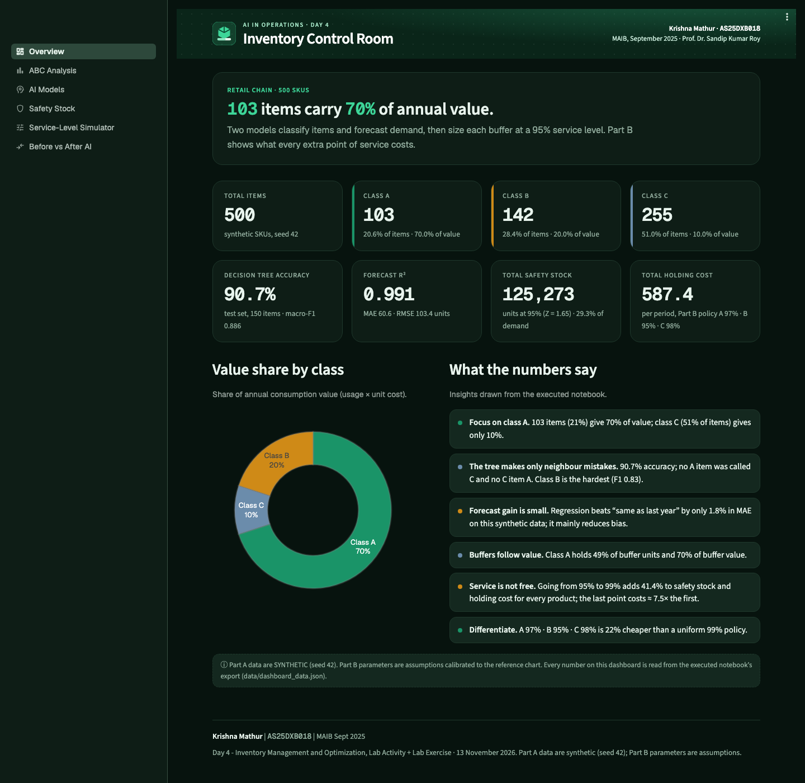
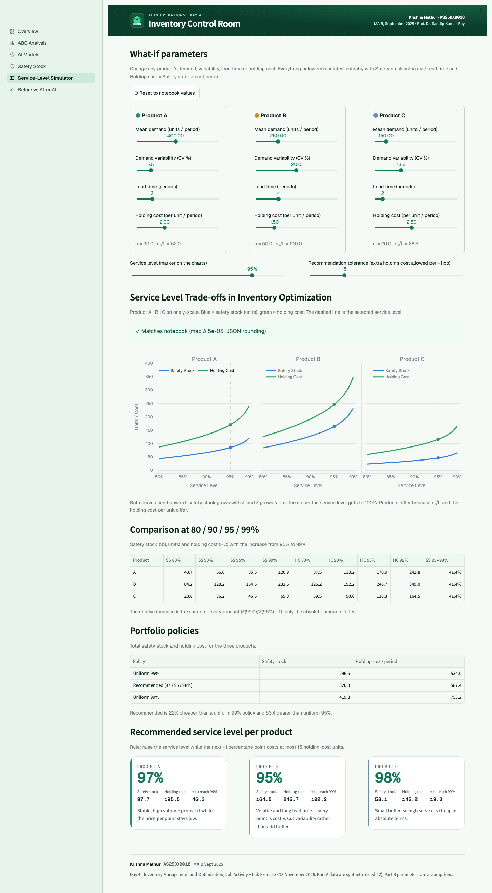
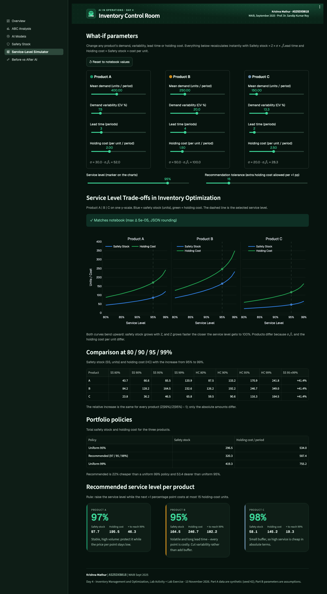

# Inventory Control Room – Day 4: Inventory Management and Optimization

**Krishna Mathur · AS25DXB018 · MAIB, September 2025 · AI in Operations (Prof. Dr. Sandip Kumar Roy)**
Task: *Day 4 – Inventory Management and Optimization, Session IV Lab Activity + Lab Exercise* · 13 November 2026

An executed Colab notebook, a one-page summary and two dashboards (Next.js and Streamlit) that all read **the same numbers** exported by the notebook.

| | Link |
|---|---|
| Google Colab notebook | {{COLAB_URL}} |
| Next.js dashboard (Vercel) | {{VERCEL_URL}} |
| Streamlit dashboard | {{STREAMLIT_URL}} |
| GitHub repository | {{GITHUB_URL}} |

> **Data note.** Part A uses a **synthetic** 500-SKU dataset (`np.random.seed(42)`), generated in the notebook following the professor's sample (`Untitled7.ipynb`). Part B parameters (demand, σ, lead time, holding cost) are my **assumptions**, calibrated to the scale of the reference chart on slide 33. Nothing here is real retail data.

## Screenshots

| Next.js – light | Next.js – dark |
|---|---|
|  |  |
|  |  |
|  |  |

| Streamlit – light | Streamlit – dark |
|---|---|
|  |  |
|  |  |

More captures (every tab, both themes, plus phone width) are in [`screenshots/`](screenshots/).

## What the project answers

**Part A – Lab Activity (inventory prioritisation for a retail chain)**
A1 ABC classification · A2 decision tree (split, accuracy, confusion matrix, report, importances, tree plot) · A3 linear-regression forecast (coefficients, R², MAE, RMSE) · A4 safety stock = Z·σ·√LT with Z = 1.65 · A5 Pareto and safety-stock charts · A6 AI vs traditional models.

**Part B – Lab Exercise (service-level trade-off simulation)**
B1 products A, B, C · B2 service levels 80–99 % · B3 Z via `norm.ppf` · B4 safety stock and holding cost · B5 the three-subplot figure · B6 comparison tables, non-linearity and per-product recommendation · B7 sensitivity to lead time and variability.

**Added for the professor – before AI vs after AI (A7, B8).** Plots of the traditional method next to the AI/data-driven one, measured on the same items.

| Decision | Before AI | After AI | Result |
|---|---|---|---|
| Classification | usage-only rule of thumb | decision tree | 64.7 % → **90.7 %** accuracy; class-A items found 18 → 27 of 31 |
| Demand forecast | next year = last year | linear regression | MAE 61.8 → 60.6 (**marginal**); bias 26 → 17 units |
| Safety stock (same budget) | flat % of last year | Z·σ·√LT | items below 90 % service 55 → **0** |
| Service levels (Part B) | uniform 95 % | 97 / 95 / 98 % | **trade-off:** +10 % holding cost, −23 % expected shortage |

The comparison is deliberately honest: the forecast gain is small on this synthetic data, and the Part B change is a trade-off, not a free win.

## Key results

* ABC: **103 items (20.6 %) carry 70 %** of annual value; class C (51 % of items) carries 10 %.
* Decision tree: **90.7 %** test accuracy, macro-F1 0.886; every error is between neighbouring classes.
* Forecast: R² 0.991, MAE 60.6, RMSE 103.4 units.
* Safety stock at 95 % (Z = 1.65): **125,273 units**; class A holds 49 % of the units.
* Service level 95 % → 99 %: **+41.4 %** safety stock and holding cost for every product; the last point costs ≈ 7.5× the first.
* Recommended levels: **A 97 %, B 95 %, C 98 %**, 22 % cheaper than a uniform 99 % policy.

## Architecture

```
notebook/…Inventory_Management.ipynb      executed, Colab-compatible (seed 42)
        │  exports
        ▼
data/dashboard_data.json  +  outputs/*.csv, *.png, metrics.json         ← single source of truth
        │                               │
        ▼                               ▼
web/  (Next.js 16 · TypeScript ·       streamlit_app/  (Streamlit · Plotly · pandas)
       Tailwind · shadcn/ui ·           reads ../data/dashboard_data.json
       Recharts · Framer Motion ·
       next-themes)
       reads public/data/dashboard_data.json
```

The simulator in both dashboards recomputes the Part B curves live from the notebook's formulas (`Z = norm.ppf(service level)`, `SS = Z·σ·√L`, `HC = SS × h`) and shows a live **“✓ Matches notebook”** check against the exported B4 table at the default parameters.

## Repository layout

```
notebook/        executed notebook (Colab-ready)
summary/         one-page A4 summary PDF
data/            synthetic dataset + dashboard_data.json
outputs/         figures (PNG), result tables (CSV), tree_metrics.json, metrics.json
web/             Next.js dashboard
streamlit_app/   Streamlit dashboard (app.py + pages/)
screenshots/     both apps, light/dark, desktop + phone
tools/           notebook builder, summary-PDF builder, sync + screenshot scripts
```

## Run locally

**Notebook** – open in Colab (File → Upload notebook) or locally:
```bash
python3 -m venv .venv && source .venv/bin/activate
pip install -r requirements.txt
jupyter nbconvert --to notebook --execute notebook/AS25DXB018_Krishna_Mathur_Day4_Inventory_Management.ipynb
```

**Next.js dashboard**
```bash
cd web
npm install
npm run dev        # http://localhost:3000
npm run build      # production build
```

**Streamlit dashboard** (from the repository root)
```bash
pip install -r streamlit_app/requirements.txt
streamlit run streamlit_app/app.py
```
Theme: use the ⋮ menu → **System / Light / Dark**. The custom styling follows that switch instantly.

## Deploy

**Vercel (Next.js)** – `vercel --prod` from `web/` (Root Directory `web`, framework Next.js; no environment variables).

**Streamlit Community Cloud** (cannot be deployed from the CLI):
1. Open <https://share.streamlit.io> and sign in with GitHub.
2. Click **Create app** → **Deploy a public app from GitHub**.
3. Repository: `{{GITHUB_REPO}}` · Branch: `main` · Main file path: `streamlit_app/app.py`.
4. Open **Advanced settings** → choose **Python 3.12** (the pinned packages need 3.11+).
5. Click **Deploy**. The first build takes a few minutes; copy the `…streamlit.app` URL into `AS25DXB018_Links.txt` and the table at the top of this file.

## Before you submit

- [ ] Upload `notebook/AS25DXB018_Krishna_Mathur_Day4_Inventory_Management.ipynb` to Google Colab (File → Upload notebook) and confirm all outputs are visible.
- [ ] In Colab: **Share → General access → Anyone with the link → Viewer**, then copy the link.
- [ ] Paste the Colab, Vercel, Streamlit and GitHub links into `AS25DXB018_Links.txt` (and the table above).
- [ ] Open `summary/AS25DXB018_Krishna_Mathur_Day4_Summary.pdf` and check it is one A4 page.
- [ ] Re-zip the project (without `node_modules`, `.next`, `.venv`) and upload the zip, notebook, PDF and links file.

## Assumptions and limitations

* Part A data are synthetic; the generator was tuned so that the ABC split resembles the textbook proportions (≈ 20 / 30 / 50 % of items). With a first sample of 200 SKUs the tree scored only ≈ 78 % on a 60-item test set and varied strongly with sample size, so the dataset was enlarged to 500 SKUs.
* Safety stock follows the professor's formula as given: Z = 1.65, σ = 10 % of predicted demand, lead time in the same unit as demand. Buffers therefore come out near 29 % of annual demand.
* The regression is a one-variable model; its R² is flattered by how the synthetic data were generated.
* Part B assumes normally distributed, independent demand and has no stock-out cost, so the recommendation uses a planner tolerance of 15 holding-cost units per extra percentage point (sensitivity: 10 and 25 give 95/92/97 % and 98/97/99 %).
* The professor's Colab demo link on slide 27 was not opened; the provided `Untitled7.ipynb` and slides 26–33 were the reference.

## License

MIT – see [LICENSE](LICENSE).
